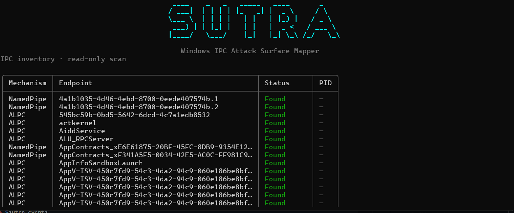

# SUTRA

Windows IPC attack surface mapper for named pipes, RPC, COM, and ALPC.



## Install

Requires Windows 10 or later and the .NET 10 SDK.

```powershell
git clone https://github.com/cranbru/sutra.git
Set-Location sutra
dotnet publish .\src\Sutra.Cli\Sutra.Cli.csproj -c Release -r win-x64 --self-contained true -p:PublishSingleFile=true
```

## Run

Double-click `sutra.exe` to open the interactive menu, or run commands in PowerShell:

```powershell
$sutra = ".\src\Sutra.Cli\bin\Release\net10.0\win-x64\publish\sutra.exe"
& $sutra scan
& $sutra scan --inspect-acl
& $sutra scan --snapshot
& $sutra history
& $sutra changes
& $sutra events
& $sutra activity
& $sutra report --format json --output .\report.json
```

With no arguments, SUTRA opens the interactive menu. Use `sutra help` to see all options.
